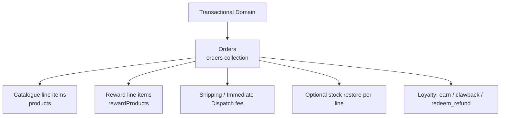
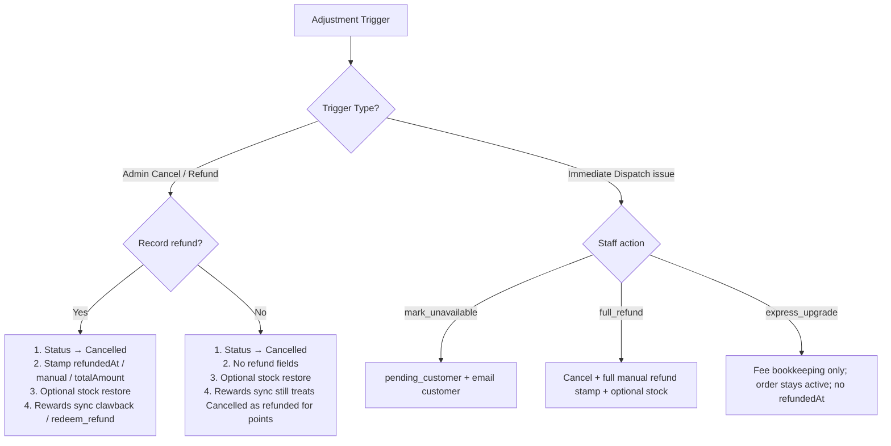

# CigarsForYou — Refund Logic Reference

Operational refund behaviour on this platform. There is **no payment processor connected** today; recorded refunds are bookkeeping only and must be processed offline. When a processor is added, `refundMethod: 'processor'` is reserved for that path.

---

### 1. Platform Policy & Governance Philosophy

1. **Refunds Are Staff-Driven, Except Stock Allocation**:
   * Customers cannot cancel an order from their account. The only customer self-serve path is a catalog stock-allocation conflict (`/order-issue`). Everything else is handled in the Admin Portal (`AdminOrders`).
2. **Zero Automated Money Movement**:
   * There is no Stripe (or other) refund API call. Ticking “Record refund” or recording an Immediate Dispatch full refund only stamps Firestore fields (`refundedAt`, `refundMethod: 'manual'`, `refundAmount`). Payment must be returned offline.
3. **Staff / Admin Discretion**:
   * Admins and staff members cancel orders, optionally mark them refunded, restore stock per line, and resolve Immediate Dispatch failures after the customer replies or calls.
4. **Immediate Dispatch Safety Valve (Human + Email)**:
   * If Didi cannot take an Immediate Dispatch order, staff mark it unavailable; the customer is emailed two options (full refund vs complimentary Express). Staff record the choice — the system does not change the order until then.
5. **Public Policy vs System**:
   * `/refund-policy` covers ACL guarantees, damage in transit, change of mind, and failed age verification at delivery. This document describes the **operational** layer (Firestore flags, stock, rewards).

---

### 2. The Domain Tree (What Can Be Refunded / Adjusted)

CigarsForYou has a single transactional domain for paid / reward fulfilment: **orders**. There are no separate event-booking or venue-hire trees.



#### Avenue: Orders (`orders`)

* **Underlying Collection**: `orders`
* **Line Structure**: Each product is an `OrderItem` (`productId`, quantity, price / points cost). Catalogue vs reward is distinguished by `source` (`Website` / etc. vs `Reward`).
* **Inventory Handling**: On cancel (or Immediate Dispatch full refund), staff can toggle restore stock per line index. Restored lines set `stockRestored: true` and increment `products/{productId}` or `rewardProducts/{productId}`.
* **Lifecycle**: Orders move through fulfilment statuses until `Fulfilled` or `Cancelled`. There is **no partial line cancel** in the admin cancel flow — cancel applies to the whole order. The only “partial money” bookkeeping path is Immediate Dispatch → complimentary Express (Immediate fee only).
* **Refund Fields** (see `src/types/index.ts`):
  * `refundedAt`, `refundMethod` (`manual` | `processor`), `refundAmount`
  * Immediate Dispatch: `immediateDispatchUnavailableAt`, `immediateDispatchResolution`, `immediateDispatchResolutionAt`, `immediateDispatchFeeRefunded`

---

### 3. The Operational Decision-Tree Pathways

When an order needs an adjustment, the platform uses one of these pathways:



#### Pathway A: Admin Cancel with Recorded Refund

* Handled in `src/pages/admin/AdminOrders.tsx` (`handleCancelOrder` with `refundSelected`).
* Sets `status: "Cancelled"`, appends status history, optionally restores stock per line.
* When refund is selected: `refundedAt`, `refundMethod: 'manual'`, `refundAmount = order.totalAmount`.
* UI copy: payment is not sent back automatically.

#### Pathway B: Admin Cancel Without Recorded Refund

* Same cancel flow with the refund checkbox off.
* Order is cancelled and stock may be restored; refund metadata is omitted.
* **Important**: rewards sync still treats `status === "Cancelled"` as refunded for points (see §4). Cancel-only does **not** retain earned points the way a “cancel without refund” path would in a processor-backed system.

#### Pathway C: Immediate Dispatch — Mark Unavailable

* Cloud function `resolveImmediateDispatch` (`functions/src/immediateDispatchRemediation.ts`), action `mark_unavailable`.
* Requires staff (admin or member role). Order must be `deliveryMethod: "immediate"` and not already `Cancelled` / `Fulfilled`.
* Sets `immediateDispatchResolution: "pending_customer"`, stamps `immediateDispatchUnavailableAt` once, emails the customer (Resend) with full refund vs complimentary Express options.
* Can resend the email if already pending.

#### Pathway D: Immediate Dispatch — Full Refund

* Action `full_refund` only after `pending_customer`.
* Cancels the order, stamps full-order manual refund (including Immediate fee), sets `immediateDispatchResolution: "full_refund"`, optional stock restore by index.
* Triggers the same rewards sync behaviour as any cancelled / refunded order.

#### Pathway E: Immediate Dispatch — Complimentary Express Upgrade

* Action `express_upgrade` only after `pending_customer`.
* Switches `deliveryMethod` to `express`, sets `shippingFee: 0`, reduces `totalAmount` by the prior Immediate fee, records `immediateDispatchFeeRefunded`.
* Does **not** set `refundedAt` and does **not** cancel the order — so loyalty points are **not** clawed back.
* Staff still return the Immediate fee offline; the system only records the fee amount.

---

### 4. How Rewards Sync Works on Cancel / Refund

Triggered by Firestore `onDocumentWritten` on `orders/{orderId}` → `syncOrderRewards` (`functions/src/rewards.ts`).

#### What counts as “refunded”

```typescript
function isRefunded(order): boolean {
  return order.status === "Cancelled"
    || (typeof order.refundedAt === "string" && order.refundedAt.length > 0);
}
```

Either cancel **or** a `refundedAt` stamp qualifies. Express upgrade (fee-only) does not qualify.

#### Catalogue / paid orders

* Points are earned when `paidAt` is set: `floor(subtotal - discountAmount)` (shipping excluded).
* On refunded: if points were earned and not yet clawed, deduct `pointsEarned` from the user, write ledger `reason: "clawback"`, set `pointsClawedBack: true`, then re-evaluate loyalty tier.
* Idempotent via `pointsClawedBack`.

#### Reward redemptions (`source === "Reward"`)

* Never earn points on placement; they spend `pointsSpent`.
* On refunded: return `pointsSpent` to the user, ledger `reason: "redeem_refund"`, set `pointsRefunded: true` (and `pointsEarned: 0`).
* Stock restore remains a separate admin choice per line.

#### Earn formula (for context)

$$\text{pointsEarned} = \lfloor \max(0,\ \text{subtotal} - \text{discountAmount}) \rfloor$$

Clawback removes the **whole order award** in one shot (not incremental partials). Partial stock-allocation refunds omit `refundedAt` so they do not claw points. A full cancel still does.

---

### 5. Ripple Effect on Loyalty Tiers

After a clawback, `reevaluateUserLoyalty` runs for that customer. Tier labels (Bronze / Silver / Gold) follow the site’s rolling loyalty rules; a clawback can reduce qualifying activity and may downgrade tier. Redeeming points for rewards is separate from clawback — cancelling a reward order returns spent points via `redeem_refund` rather than a spend clawback.

Express upgrade leaves points and tier evaluation untouched for that order’s earn.

A partial stock-allocation refund also leaves the earn in place. Cancelling the whole order from that flow claws it, the same as any other cancel.

---

### 6. Catalog stock allocation conflict

Paid catalog checkout (still gated in the storefront) creates an order with `stockAllocationStatus: "pending"`, then `allocateOrderStock` decrements `products` stock inside a transaction.

* If every line fits, status becomes `allocated` and fulfilment can proceed.
* If any line is short, status becomes `conflict`, fulfilment is paused, and the customer has **60 minutes** on `/order-issue`.
* Copy on that page treats it as an error on our end. It does not describe the cart hold timer.
* The customer can refund the whole order, or refund individual quantities. The unallocated quantity on each short line is mandatory and cannot be reduced. They may refund additional quantity up to the full line.
* If they leave the page, a scheduled job (`applyStockConflictDefaults`, every 15 minutes) cancels and records a refund for **only the unallocated quantity** after the deadline. Further changes need a direct contact.
* Either resolution creates a one-time fixed `$25` coupon (`usageLimit: 1`) if one was not already created when the conflict was detected, and emails it. The cart floors fixed discounts so the merchandise total cannot go below $0; unused value does not roll over.
* Full cancel sets `refundedAt`, `refundMethod: "manual"`, and `refundAmount` to the order total, and restores stock that was actually allocated.
* A partial keep-the-rest resolution sets `partialRefundedAt` and `refundAmount` for the cancelled merchandise only (shipping stays unless the order becomes empty). It does **not** set `refundedAt`. Money is still returned offline until a processor is connected.
* `advanceOrderStatus` refuses while `stockAllocationStatus` is `conflict` or `fulfilmentPaused` is true.

---

### Summary Matrix

| Avenue / Action | Money Moved Automatically? | Refund Fields Stamped? | Points Effect | Inventory Freed? | Can Affect Tier? |
| :--- | :---: | :---: | :--- | :---: | :---: |
| **Admin cancel + record refund** | No (offline) | **Yes** (`manual`, full `totalAmount`) | Clawback earn **or** redeem_refund | Optional per line | **Yes** (if earn clawed) |
| **Admin cancel only** | No | No | Still clawback / redeem_refund (`Cancelled` ⇒ refunded) | Optional per line | **Yes** (if earn clawed) |
| **Immediate: mark unavailable** | No | No | None yet | No | No |
| **Immediate: full refund** | No (offline) | **Yes** (full order) | Same as cancelled/refunded | Optional per line | **Yes** (if earn clawed) |
| **Immediate: Express upgrade** | No (offline fee return) | Fee only (`immediateDispatchFeeRefunded`) | **None** (no `refundedAt`) | No | No |
| **Stock conflict: full cancel** | No (offline) | **Yes** (`manual`, full `totalAmount`) | Clawback (order cancelled) | Allocated units restored | **Yes** (if earn clawed) |
| **Stock conflict: partial / timeout** | No (offline) | Partial only (`partialRefundedAt`, no `refundedAt`) | **None** | Only allocated units the customer also cancels | No |
| **Customer self-refund (other)** | N/A — not supported | — | — | — | — |
| **Payment processor refund** | Not wired yet | `refundMethod: 'processor'` reserved | Would ride same sync when cancel / `refundedAt` written | — | — |

---

### Key Source Files

| Area | Location |
| :--- | :--- |
| Order refund / Immediate fields | `src/types/index.ts` |
| Admin cancel + refund UI | `src/pages/admin/AdminOrders.tsx` |
| Immediate Dispatch remediation | `functions/src/immediateDispatchRemediation.ts` |
| Client callable wrapper | `src/services/immediateDispatchRemediation.ts` |
| Rewards earn / clawback / redeem_refund | `functions/src/rewards.ts` |
| Orders write trigger | `functions/src/index.ts` (`syncOrderRewardsOnWrite`) |
| Customer email (unavailable options) | `functions/src/email.ts` |
| Catalog stock allocation / conflict | `functions/src/stockAllocation.ts` |
| Stock-issue page | `src/pages/OrderStockIssuePage.tsx` |
| Public policy copy | `src/pages/LegalPage.tsx` (`/refund-policy`) |
