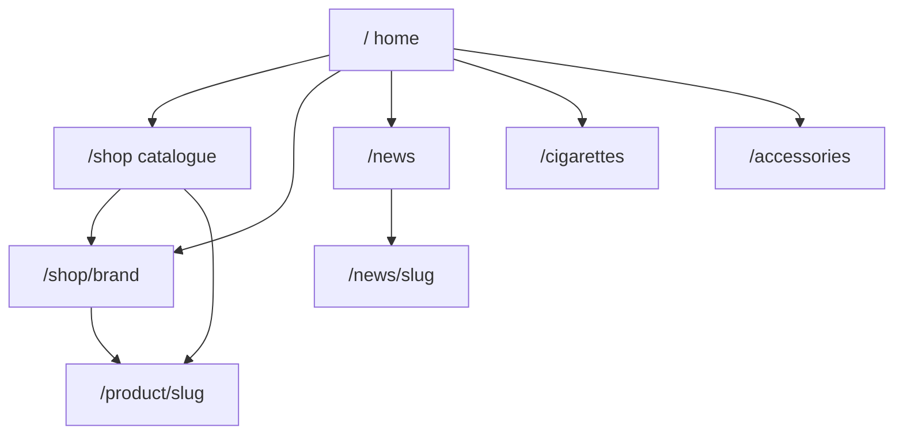

# Site crawl — cigarsforyou.com.au

Crawled 5 October 2026 (UTC+11) against production. HTTP status and redirects are from direct requests. Titles, H1s, and links are from a rendered crawl (Playwright, age gate satisfied in `localStorage` as `cfy_age_verified_v1`) because every route returns the same SPA shell. Catalog dates come from Firestore. The row-level inventory is [seo-inventory.csv](seo-inventory.csv). Findings are in [seo-inventory.md](seo-inventory.md).

Live sitemap: `https://cigarsforyou.com.au/sitemap.xml` — **109 URLs**. The copy in `public/sitemap.xml` has **110** and adds `/cookies`, which is not on the live host yet.

## Architecture

Firebase Hosting rewrites every path to `/index.html`. React Router in `src/App.tsx` picks the page. Products, categories, and news come from Firestore. There is no SSR. The HTML Google fetches before JavaScript is one title and one description for the whole site. There is no `rel=canonical`, no meta robots, and no JSON-LD.

Brand links in the nav and footer point at `/shop/{slug}`. The nav also points at `/shop?category=specials` and `/shop?category=cigars`. The catalogue does not read `category`. It reads the path slug, `?brand=`, and `?search=`.

| Page type | URL pattern | Source | In live sitemap | Robots |
|-----------|-------------|--------|-----------------|--------|
| Home | `/` | `HomePage` | Yes | Allow |
| HTML | `/about`, `/contact`, `/partnerships` | page components | Yes | Allow |
| Legal | `/terms`, `/privacy`, `/refund-policy`, `/compliance` | `LegalPage` | Yes | Allow |
| Legal, not live | `/cookies` | in source, not in the live JS bundle | No | Allow, but renders an empty shell |
| Cigar catalogue | `/shop` | Firestore `products` | Yes | Allow |
| Cigar brand | `/shop/{slug}` | Firestore `catalogCategories` | Yes, 9 brands | Allow |
| Cigarettes | `/cigarettes`, `/cigarettes/{slug}` | same catalogue, range `cigarettes` | Index only | Allow |
| Accessories | `/accessories`, `/accessories/{slug}` | same, range `accessories` | Index only | Allow |
| Product | `/product/{slug}` | Firestore `products` where `active` is not false | Yes, 83 | Allow |
| News index | `/news` | Firestore `newsPosts` | Yes | Allow |
| Article | `/news/{slug}` | published `newsPosts` | Yes, 5 | Allow |
| Search | `{catalogue}?search=` | query on the catalogue | No | Allow, no noindex |
| Filter | `/shop?brand=` | legacy brand query | No | Allow, no noindex |
| Parameter | `/shop?category=` | linked in the nav, ignored by the page | No | Allow, no noindex |
| Utility | `/cart`, `/checkout`, `/checkout-details`, `/order-confirmation`, `/account`, `/login`, `/signup`, `/forgot-password`, `/age-restricted` | app routes | No | Disallow |
| Admin | `/admin`, `/admin/login`, `/admin/*` | admin portal | No | Disallow |

There is no `/search` route. Sort and “in stock only” stay in React state and do not create URLs.

## URL census

| Class | Count | Notes |
|-------|------:|-------|
| Live sitemap URLs | 109 | 83 products, 9 brand categories, `/shop`, `/cigarettes`, `/accessories`, `/news`, 5 articles, 8 core/legal pages |
| Products in Firestore | 83 | all `active`; none excluded |
| Categories in Firestore | 9 | all cigars; no cigarette or accessory categories |
| News posts | 5 | all active |
| Inactive or unpublished records | 0 | |
| Rendered for this inventory | 127 | sitemap URLs, `/cookies`, sampled parameters, disallowed utility/admin routes |

## HTTP, redirects, trailing slash

Every apex path that was requested returned **200**, including unknown paths. Hosting does not emit 404s.

| Request | Result |
|---------|--------|
| `https://cigarsforyou.com.au/` | 200 |
| `http://cigarsforyou.com.au/` | 301 → `https://cigarsforyou.com.au/` → 200 |
| `http://www.cigarsforyou.com.au/` | 301 → `https://www.cigarsforyou.com.au/` |
| `https://www.cigarsforyou.com.au/` | TLS failure: certificate has no name for `www` |
| `/shop/` and `/product/cohiba-robustos/` | 200, same H1 and main text as the slashless URL |
| Unknown paths below | 200 |

No trailing-slash, `www` → apex, or legacy path redirects are configured. Slash and non-slash URLs both render the page, and nothing in the HTML says which one is canonical.

## Broken and soft-404 URLs

| URL | What the crawl saw |
|-----|--------------------|
| `https://www.cigarsforyou.com.au/` | Unreachable. Certificate name mismatch. |
| `/cookies` | 200 and an empty `<main>`. The live bundle has no `/cookies` route and the live footer does not link it. `public/sitemap.xml` lists it; the live sitemap does not. |
| `/product/this-slug-does-not-exist` | 200. Visible heading is an `h2`: “Product Not Found”. No `h1`. |
| `/news/this-story-does-not-exist` | 200. H1: “That story is not on the site”. |
| `/this-path-does-not-exist` | 200. Empty `<main>`. No route matched. |
| `/shop/not-a-real-brand` | 200. H1 is the raw slug plus “Cigars”, then “0 products”. Any `/shop/{slug}` is a page. |

## Parameter URLs

Sampled, not enumerated. Query strings are open-ended.

| Sample | Rendered as | Relationship |
|--------|-------------|--------------|
| `/shop?search=cohiba` | H1 “Cuban Cigars”, filtered grid | Search results URL. Not in the sitemap. No noindex. |
| `/cigarettes?search=marlboro` | Same coming-soon page as `/cigarettes` | Search on an empty range. |
| `/shop?brand=Cohiba` | H1 “Cohiba Cigars” | Same view as `/shop/cohiba`. |
| `/shop?category=specials` | H1 “Cuban Cigars”, full 83-product grid | Same document as `/shop`. `category` is not read. Both navs link here. |
| `/shop?category=cigars` | Same as `/shop` | Same issue. |
| `/checkout?mode=rewards` | “Rewards checkout is empty” | Disallowed by `robots.txt` via `/checkout`. |

`?internal` and `?ga_debug` are stripped by the analytics listener after they set a cookie. `?tab` and `?panel` only change `/account`. `?mode=rewards` and `?orderNumber=` sit on disallowed checkout URLs.

## Indexability as crawled

- `robots.txt` allows `/` and disallows admin, cart, checkout, account, auth, order confirmation, and `/age-restricted`.
- No page sets a robots meta tag.
- No page sets a canonical.
- 121 of the 127 inventoried URLs share the sitewide `<title>`: `CigarsForYou — Premium Cuban Cigars & Subscription Delivery`. Only `/news` and the five articles set their own title after JavaScript runs.
- The age gate is client-side. This crawl bypassed it. A crawler that does not run JavaScript, or that does not accept the gate, does not see the H1s in this inventory.
